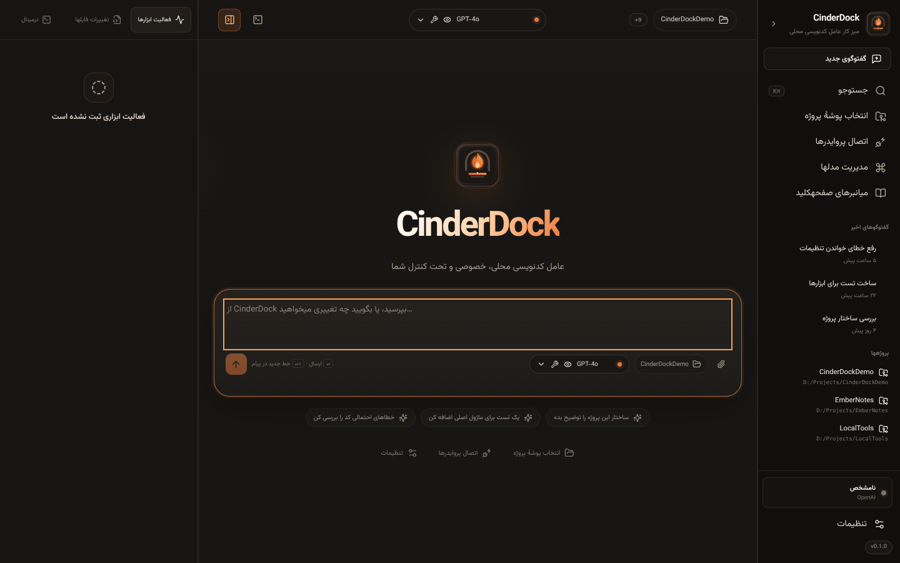
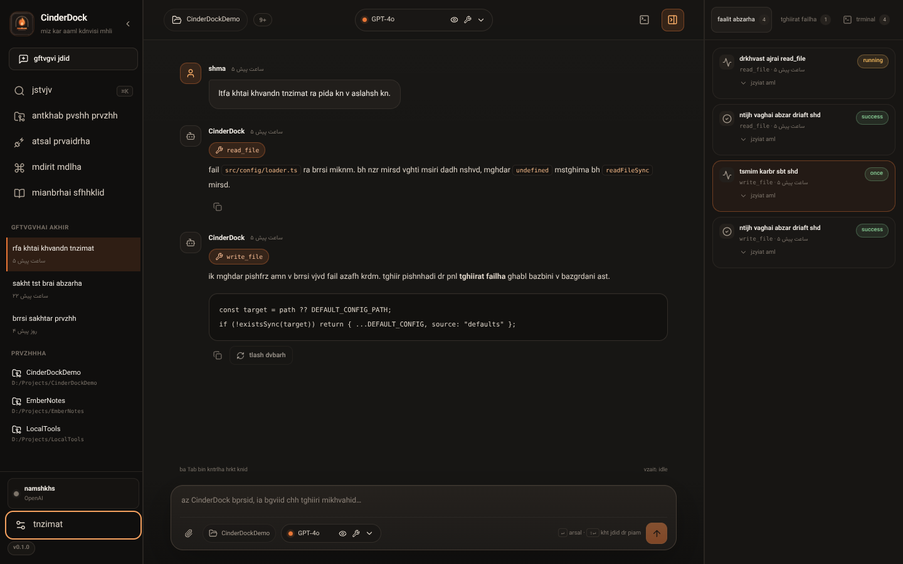
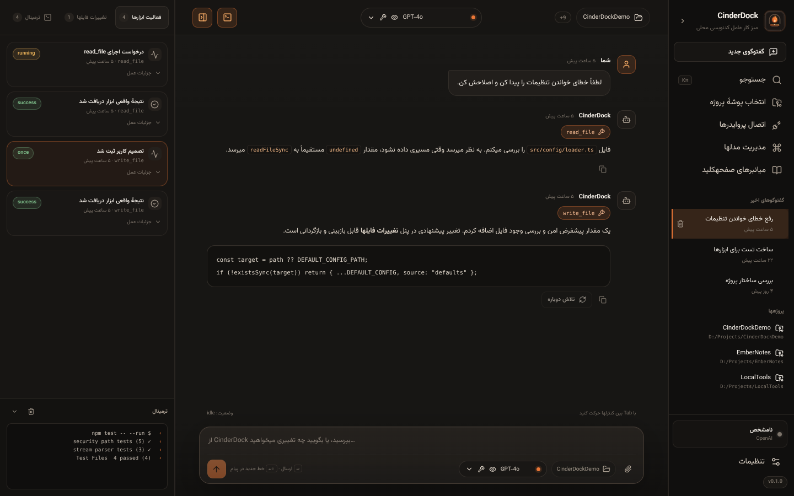
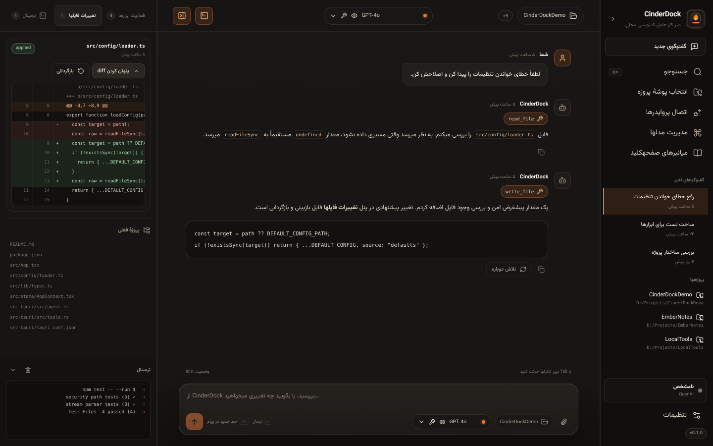
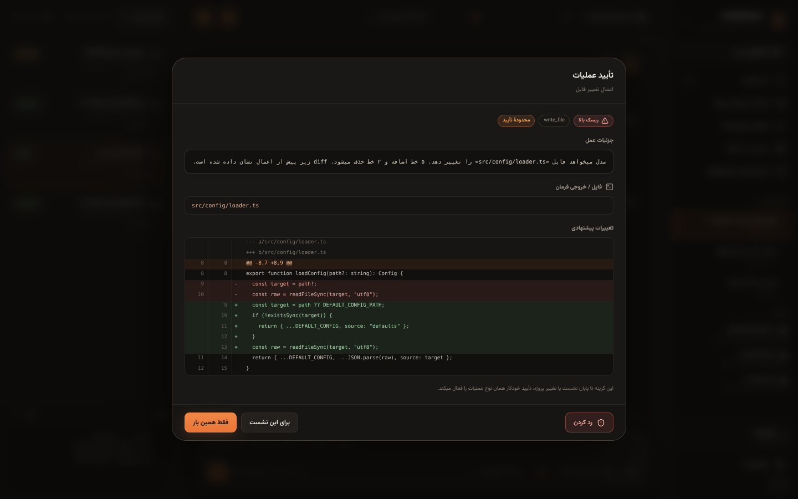
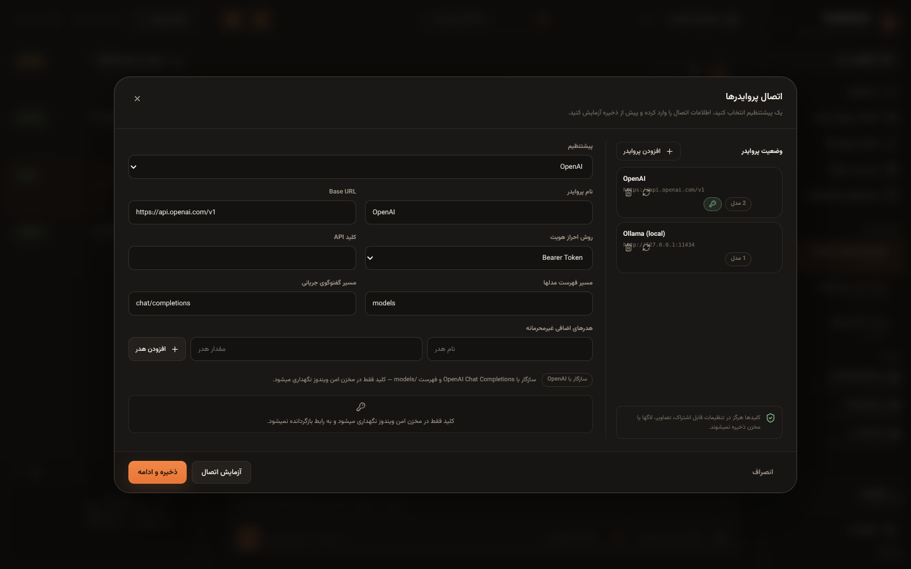
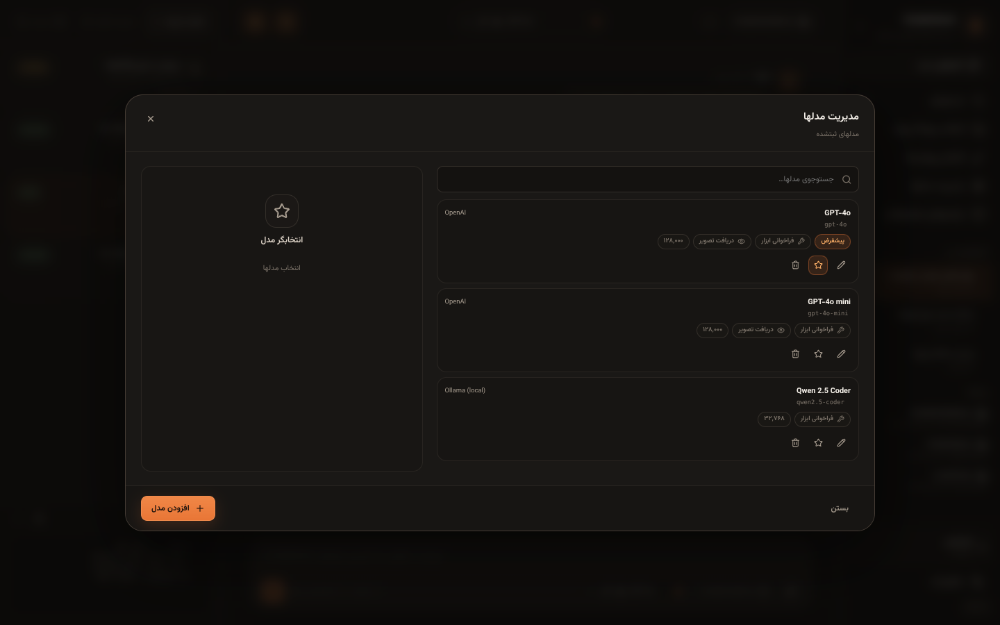

<div align="center">
  
  <h1>CinderDock</h1>
  <p><strong>A local-first Windows desktop agent for real project work.</strong></p>
  <p>
    <a href="https://github.com/Manixpcshot/cinderdock/actions/workflows/ci.yml"></a>
    <a href="LICENSE"></a>
    <a href="https://github.com/Manixpcshot/cinderdock/releases"></a>
  </p>
</div>

CinderDock is a genuinely usable, open-source Windows 10/11 x64 desktop app built with **Tauri 2, React, TypeScript, Vite and Rust**. The React layer is presentation only: provider communication, agent orchestration, tools, filesystem/command access, approvals, persistence and secrets all live in the Rust core. There is no Electron, mandatory cloud account, telemetry, or Python runtime.

> **فارسی:** CinderDock یک میز کار عامل کدنویسی محلی برای ویندوز است. کلیدهای API فقط در مخزن امن ویندوز نگهداری میشوند، گفتوگوها در SQLite محلی ذخیره میشوند، و قبل از هر تغییر فایل یا اجرای فرمان، diff و جزئیات عملیات برای تأیید نمایش داده میشود.

## Real app screenshots

The images below are captured from the built CinderDock interface with non-sensitive sample data. The screenshot harness uses the real React components and design tokens; no provider key or personal conversation is included.

<p align="center">
  
  
</p>
<p align="center">
  
  
</p>
<p align="center">
  
  
</p>
<p align="center">
  
</p>

## What works

- **In-app provider wizard** — no JSON editing: OpenAI-compatible custom endpoints plus ready-made OpenAI, OpenRouter, DeepSeek, Ollama, and LM Studio presets. Ollama also has a genuine native `/api/chat` adapter instead of a false OpenAI-compatibility claim.
- **Multiple providers and models at once** — real model IDs, display names, linked provider, tool-calling capability, image-input capability, searchable picker, default model, and per-chat model switching. Model discovery uses supported APIs; manual model IDs always remain available.
- **Streaming agent loop** — streamed responses, stop, bounded retries, saved conversations, and a bounded tool-call loop with repeated-call detection.
- **Real tools** — list/read files, project search, create/edit files, command execution, Git status/diff, DuckDuckGo web search, and public web-page fetch. Optional Windows desktop control tools (screenshot, click, type, scroll) are off by default and require explicit per-use approval.
- **Visible safety** — detailed confirmation with “only once”, “for this session”, or “deny” before writes, commands, desktop control or other risky actions. File diffs are shown before applying and can be confirmed, rejected or reverted. Denial really stops the tool path.
- **Local persistence** — SQLite with idempotent migrations, conversation search/delete, message history, tool events, file changes and approval decisions.
- **Persian + RTL + Finglish + Latin-only** — native Persian RTL, an approximate display-only Finglish transliterator, and a Latin-only mode with English UI copy. Stored messages are never rewritten.
- **Independent identity** — original CinderDock mark, icons, copy and visual language; no Claude branding or proprietary assets.

## Requirements and honest installation notes

- Windows 10 or Windows 11, x64.
- **Microsoft Edge WebView2 Runtime.** The NSIS installer uses Tauri's silent WebView2 bootstrapper. The portable `.exe` is portable in the sense that it does not require installation, **but it is not fully standalone**: WebView2 and the normal Windows system libraries must already be present.
- A configured model provider and at least one model ID. CinderDock does not bundle a model.

Download the four release files from [GitHub Releases](https://github.com/Manixpcshot/cinderdock/releases):

| File | Purpose |
| --- | --- |
| `CinderDock-vX.Y.Z-windows-x64-portable.exe` | Single-file launcher, no installer |
| `CinderDock-vX.Y.Z-windows-x64-setup.exe` | Per-user NSIS installer |
| `CinderDock-vX.Y.Z-source.zip` | Source archive from the same tag |
| `SHA256SUMS.txt` | SHA-256 digests for the three artifacts above |

Verify the hash before running either executable:

```powershell
Get-FileHash .\CinderDock-v0.1.0-windows-x64-portable.exe -Algorithm SHA256
```

## Quick start

1. Launch CinderDock.
2. Open **Provider connections** and choose a preset. Enter display name, Base URL, authentication method, API key, optional non-secret headers, and endpoint paths. Click **Test connection**, then **Save and continue**.
3. Fetch the model list where supported, select real model IDs, set tool/vision capabilities, or enter a model ID manually. Choose a default.
4. Choose a project folder. File tools are restricted to that folder by default.
5. Write a message and press Enter. For file changes or commands, review the diff/details and choose **Only this time**, **For this session**, or **Deny**.
6. Inspect activity, file diffs and terminal output in the right inspector. Re-open a recent chat later; conversation history and file changes are local.

Keyboard shortcuts are listed in the app (`Ctrl/⌘ + K` opens search). Every interactive control is reachable by keyboard and has a visible focus ring.

## Configuration and secrets

Non-secret configuration is stored in a documented JSON file:

```text
%APPDATA%\CinderDock\settings.json
```

See [docs/SETTINGS.md](docs/SETTINGS.md) for the schema and a safe example. It contains provider metadata, model metadata, preferences, project path and recent projects. It **never** contains API keys.

On Windows, API keys are encrypted with **DPAPI for the current Windows user** and stored outside `settings.json`. The UI never receives a saved key back. Logs and streamed events pass through a redaction layer. On non-Windows development builds, secrets are held only in memory and are never written as plaintext.

## Architecture

```text
React / TypeScript / Vite  ── Tauri IPC ──>  Rust core
        │                                      │
        ├─ design tokens / components          ├─ provider adapters + SSE/NDJSON
        ├─ state + event rendering             ├─ bounded agent + tool loop
        └─ RTL / Finglish display             ├─ approvals + path/command guards
                                               ├─ SQLite + settings.json
                                               └─ DPAPI secret store
```

Full details: [docs/ARCHITECTURE.md](docs/ARCHITECTURE.md). Provider setup: [docs/PROVIDERS.md](docs/PROVIDERS.md). Security model: [docs/SECURITY_MODEL.md](docs/SECURITY_MODEL.md).

## Development

```bash
npm ci
npm run tauri dev
```

Useful checks:

```bash
npm run lint
npm run typecheck
npm test
npm run build
cd src-tauri && cargo fmt --check && cargo clippy --all-targets --all-features -- -D warnings && cargo test
npm run screenshots
```

More: [docs/LOCAL_DEVELOPMENT.md](docs/LOCAL_DEVELOPMENT.md), [docs/WINDOWS_BUILD.md](docs/WINDOWS_BUILD.md), and [docs/RELEASE.md](docs/RELEASE.md).

## Release policy

Every update to `main` must bump the semantic version in `package.json`, `src-tauri/tauri.conf.json`, `src-tauri/Cargo.toml` and the changelog. CI verifies consistency, Rust formatting/Clippy/tests, TypeScript checks, UI tests, and a real `windows-latest` build. A `vX.Y.Z` tag and GitHub Release are created only after those checks, the Windows build, and the portable-executable smoke test succeed. In-app updates remain disabled until valid signature verification and secure private-key custody are implemented.

See [CHANGELOG.md](CHANGELOG.md) and [docs/RELEASE.md](docs/RELEASE.md).

## Known limitations

- The portable executable still requires WebView2; “portable” does not mean fully standalone.
- Ollama native tool calling works only with Ollama versions and models that actually support tools; unknown capabilities default to off.
- DuckDuckGo HTML search is best-effort and can change or rate-limit; `fetch_webpage` blocks private network hosts.
- Desktop-control screenshots may contain sensitive information visible on screen. They require a separate approval and are not persisted, but the user must still avoid exposing secrets on screen.
- In-app updates are intentionally disabled in this release.
- Only Windows x64 artifacts are produced by the release workflow.

## Contributing and security

Read [CONTRIBUTING.md](CONTRIBUTING.md) before opening a PR. Please report vulnerabilities privately as described in [SECURITY.md](SECURITY.md). Do not paste API keys, tokens, personal chats or screenshots containing secrets into issues, PRs, logs or settings files.

## License

MIT — see [LICENSE](LICENSE). Third-party notices are in [THIRD_PARTY_NOTICES.md](THIRD_PARTY_NOTICES.md).
